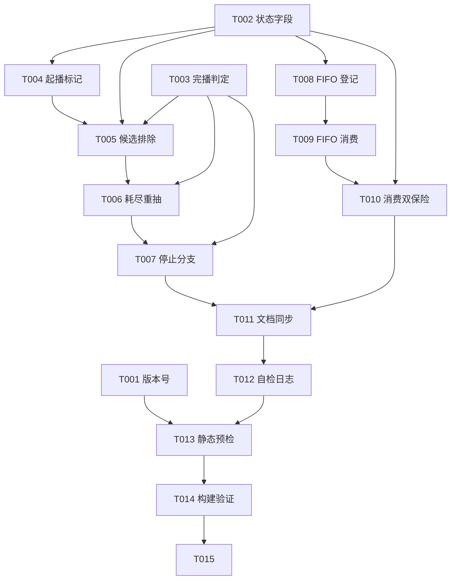

# Tasks: v0.8-part1 随机播放去重与随机下一首播放

**Input**: Design documents from `spec/v0.8-part1-random-play-next/`
**Prerequisites**: plan.md（已就绪）、spec.md（已就绪）

**Tests**: 未请求测试套件（plan D7：项目零测试现状，关键路径留 Logger.log 供真机自查）

**Organization**: 改动集中于 `entry/src/main/ets/service/PlayerController.ets` 单文件，任务按用户故事分组、顺序执行（同文件无并行收益）

## Format: `[ID] [P?] [Story] Description`

- **[P]**: 可并行（不同文件、无未完成依赖）
- **[Story]**: 所属用户故事（US1-US4）

## Path Conventions

- 单项目仓库：`entry/src/main/ets/` 为源码根，`AppScope/` 为应用级配置，`docs/` 为活文档
- 本批涉及文件：`entry/src/main/ets/service/PlayerController.ets`（全部核心改动）、`AppScope/app.json5`（版本号）、`docs/architecture.md`（机制描述同步）

---

## Phase 1: Setup

- [X] T001 [P] 升级应用版本号：`AppScope/app.json5` versionName `0.7.0`→`0.8.0`、versionCode `7000`→`8000`（FR-010 / US4）

---

## Phase 2: Foundational（阻塞前置）

**目的**：全部用户故事依赖的播控状态与判定基座

- [X] T002 在 `entry/src/main/ets/service/PlayerController.ets` 新增两个私有内存态字段：会话已播集（`Set<string>`，bvid 条目级键）与指定下一首队列（`string[]` 复合键 FIFO）；遵循零装饰器广播模式，不加任何观测装饰器（plan D2/D4）
- [X] T003 在 `entry/src/main/ets/service/PlayerController.ets` 新增完播派生判定私有 helper：单条目完播判定（歌单内该 bvid 全部分P 在 playHistory 中 progress=-1）、全完播判定（FR-001 / plan D3，纯查询零副作用）

---

## Phase 3: User Story 1 - 随机播放不重复已播条目 (Priority: P1) 🎯 MVP

**Goal**: 随机抽取排除本会话已起播条目与完播条目

**Independent Test**: 随机模式全新会话连续切歌 N 次（N ≤ 候选条目数），抽中条目两两不同

- [X] T004 [US1] 在 `entry/src/main/ets/service/PlayerController.ets` 的 AVPlayer `'playing'` 状态分支（`recordOnPlaying` 同点）写入会话已播标记：当前条目 bvid 加入已播集；prepare 失败路径天然不经过此点不标记（FR-002 / plan D1）
- [X] T005 [US1] 改造 `randomIndex()`（`entry/src/main/ets/service/PlayerController.ets`）候选构建：候选组 = 条目组 − 已播 bvid − 完播 bvid − 当前组；组内连播优先级与回退兜底不动（FR-001 / plan D6）

---

## Phase 4: User Story 2 - 已播耗尽重抽与全完播停止 (Priority: P2)

**Goal**: 候选耗尽从未完播重抽；全部完播后自动连播停止

**Independent Test**: 小歌单（2-3 条目）随机连播到底，重抽只覆盖未完播、全完播后停止

- [X] T006 [US2] 在 `randomIndex()` 耗尽分支（`entry/src/main/ets/service/PlayerController.ets`）实现重抽：候选空且存在未完播条目 → 清空会话已播集就地重建候选（当前组仍排除）；候选空且全完播 → 维持回退重播当前（FR-003 / plan D6）
- [X] T007 [US2] 在 `handleCompleted()`（`entry/src/main/ets/service/PlayerController.ets`）新增 RANDOM 分支：指定下一首队列为空且全完播时走 US7 同款停止路径（statusMsg='播放结束'、currentItemEnded=true、playIntent=false），否则照旧 `next()`；顺序/倒序 US7 逻辑零改动；手动 next 不改停止语义（FR-004 / plan D5）

---

## Phase 5: User Story 3 - 随机模式「下一首播放」兑现 (Priority: P3)

**Goal**: 源页 insertAfterCurrent 插入条目按序兑现为随机模式下一首

**Independent Test**: 随机模式播放中源页「下一首播放」插入 1 条后点「下一首」，播放的是插入条目

- [X] T008 [US3] 在 `loadPlaylistAndPlay()`（`entry/src/main/ets/service/PlayerController.ets`）实现 FIFO 登记：非空歌单且实际插到当前条目游程之后（afterCurrent 用户意图判定：insertAfterCurrent 且命中当前游程，含游程在队尾、insertAt 恰等于原长度的场景）时，`toAdd` 各条目复合键按序入队；命中去重跳过项、非 insertAfterCurrent 的纯追加队尾路径不登记；空歌单重生成分支已播集与 FIFO 随 shuffleHistory/forwardHistory 一并清空（FR-005/FR-007/FR-011 / plan D4）
- [X] T009 [US3] 在 `randomIndex()`（`entry/src/main/ets/service/PlayerController.ets`）组内连播之后插入 FIFO 消费：弹出队首键，`indexOfKey` 校验在歌单则返回该下标跳播，不在则丢弃续弹；优先级链 = 组内连播 > 指定下一首 > 排除式随机抽取（FR-006 / plan D4）
- [X] T010 [US3] FIFO 消费与剔除双保险（`entry/src/main/ets/service/PlayerController.ets`）：`'playing'` 分支同步剔除当前条目复合键（手动点播视为消费）；`removeSelectedFromPlaylist()` 移除后剔除被移键（FR-007 / plan D4）

---

## Phase 6: Polish

- [X] T011 [P] 检查 `docs/architecture.md` 是否记载随机播放机制描述，有则同步（分层排除、指定下一首队列、全完播停止）；未记载不新增；源码无文件增删，架构文件表零变化（plan「文档同步」契约）
- [X] T012 [P] 关键路径自检日志核查：重抽触发、FIFO 消费、停止判定三处已留 Logger.log 且不泄漏敏感信息（plan D7），文件 `entry/src/main/ets/service/PlayerController.ets`

---

## Phase 7: Verification

<!-- verification_scope: build-only -->

**目的**: 构建验证通过即收尾，默认停到真机前（项目规范）

- [x] T013 静态预检：`arkts_check` 传入本轮触碰的 `entry/src/main/ets/service/PlayerController.ets`，修复报告项后复检（一次通过：目标文件零错误零告警，37 条告警均为依赖文件既有项）
- [x] T014 构建验证：`devecocli build` 并修复编译错误（fix → build 循环直至通过）（一次通过：BUILD SUCCESSFUL，零修复）
- [x] T015 收尾停点：不执行真机部署/运行/UI 验证，构建通过即收尾；真机自查事项由主代理在轮次总结中集中输出（项目规范：默认停到真机前）

---

## Dependencies & Execution Order

### Phase Dependencies

- **Setup (Phase 1)**: T001 独立（不同文件），可先行
- **Foundational (Phase 2)**: T002/T003 阻塞全部用户故事
- **User Stories (Phase 3-5)**: 依赖 Foundational；同文件严格按依赖序执行
- **Polish (Phase 6)**: 依赖全部用户故事完成
- **Verification (Phase 7)**: 依赖 Polish 完成；严格串行

### 📊 Dependency Graph



### ⚡ Parallel Execution Guide

| Phase | Tasks | Required Files | Execution Notes |
|---|---|---|---|
| Setup | T001 | AppScope/app.json5 | 独立文件，可与 T002-T010 并行 |
| Foundational | T002, T003 | PlayerController.ets | 同文件顺序执行 |
| US1-US3 | T004-T010 | PlayerController.ets | 同文件严格按依赖序执行，无并行收益 |
| Polish | T011, T012 | docs/architecture.md、PlayerController.ets | 可并行（不同文件） |
| Verification | T013-T015 | — | 严格串行 |

## Parallel Example

```text
# Setup 与核心改动并行（不同文件）：
Task: "T001 升级应用版本号 in AppScope/app.json5"
Task: "T002 新增播控状态字段 in entry/src/main/ets/service/PlayerController.ets"

# Polish 阶段并行（不同文件）：
Task: "T011 文档同步 in docs/architecture.md"
Task: "T012 自检日志核查 in entry/src/main/ets/service/PlayerController.ets"
```

## Implementation Strategy

- 单轮实施：T001-T012（改动集中于单文件，体量小无需分批）
- 验证轮：T013-T015（build-only，构建通过即收尾停到真机前）
- MVP：US1（T002-T005）即可独立交付「随机不重复已播」

## Notes

- 全部任务在既有项目内完成，无新文件、无新依赖
- 随机优先级链一处维护于 `randomIndex` 及 `next()` 决策序，勿在其他位置重复实现（plan Contracts）
- 顺序/倒序模式、列表页移动、prev() 回溯为回归红线，实施中不得触碰其逻辑
