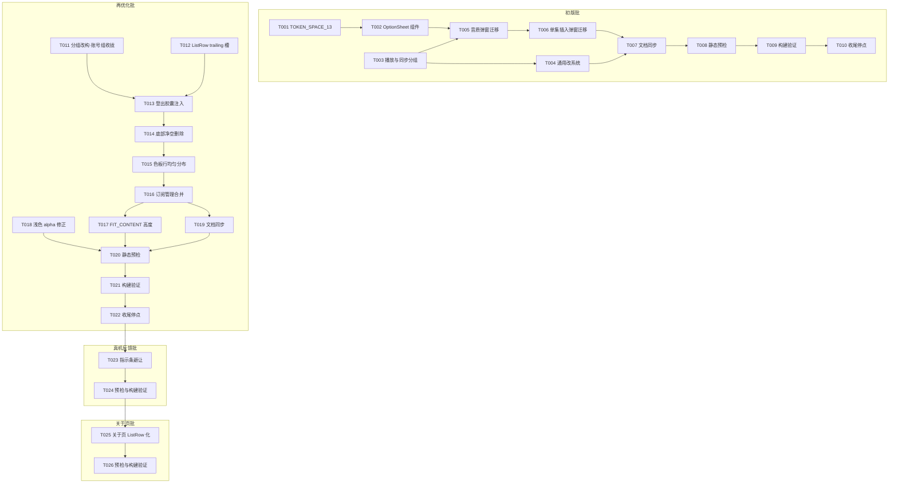

# Tasks: v0.8-part2 设置页分组重组与选项弹窗公共组件

**Input**: Design documents from `spec/v0.8-part2-settings-regroup/`
**Prerequisites**: plan.md（已就绪）、spec.md（已就绪）；T001-T010 已实施完成（初版批），T011 起为再优化批（同轮就地修正，需求经多轮反馈收敛为终版）

**Tests**: 未请求测试套件（plan Technical Context：项目零测试现状，验证 = arkts_check + build）

**Organization**: 改动集中于 `entry/src/main/ets/pages/SettingsPage.ets`（同文件任务严格顺序）；ListRow/color.json/architecture.md 为不同文件可并行

## Format: `[ID] [P?] [Story] Description`

- **[P]**: 可并行（不同文件、无未完成依赖）
- **[Story]**: 所属用户故事（US1-US3）

## Path Conventions

- 单项目仓库：`entry/src/main/ets/` 为源码根，`docs/` 为活文档
- 初版批涉及文件：`entry/src/main/ets/component/OptionSheet.ets`（新增）、`entry/src/main/ets/pages/SettingsPage.ets`、`entry/src/main/ets/service/Constants.ets`（增令牌）、`docs/architecture.md`
- 再优化批涉及文件：`entry/src/main/ets/pages/SettingsPage.ets`（核心）、`entry/src/main/ets/component/ListRow.ets`（行尾槽位）、`entry/src/main/resources/base/element/color.json`（浅色 alpha）、`docs/architecture.md`（同步）；OptionSheet 组件与 Constants 再优化批零改动

---

## Phase 1: Foundational（阻塞前置）

**目的**: OptionSheet 组件与令牌基座，阻塞 US3 两处迁移

- [X] T001 [P] `entry/src/main/ets/service/Constants.ets` 新增 `TOKEN_SPACE_13 = 13`（承载现状选项行上下内边距 13，数值不变，归入 TOKEN_SPACE_* 令牌区）
- [X] T002 新建 `entry/src/main/ets/component/OptionSheet.ets`：`@ComponentV2` 纯展示选项弹窗面板，`@Param title / notice（默认 ''）/ optionLabels / selectedLabel` + `onSelect: (index: number) => void`；结构 = 根 Column（内容自适应高度 + `backgroundColor($r('app.color.sheet_background'))`）→ 固定标题（`TOKEN_FONT_17` 加粗）→ 可选固定通知区（空串不渲染）→ `Scroll` + `edgeEffect(EdgeEffect.Spring)` 内容自适应选项列表；行渲染内聚（label + 选中 ✓ 强调色，行内边距 `TOKEN_SPACE_13`、字号 `TOKEN_FONT_BODY_L`、左右 `TOKEN_SPACE_L`，与现状面板一致）（depends on T001）

---

## Phase 2: User Story 1 - 「播放与同步」新分组 (Priority: P1) 🎯（初版批，已被再优化批 T011 修订）

**Goal**: 四行收拢进新分组，账号/播放设置/通用三组对应瘦身，行为零变化

**Independent Test**: 登录态打开设置页，逐分组核对行归属；未登录态核对仅 2 行；各开关/入口行为与重组前一致

- [X] T003 [US1] `entry/src/main/ets/pages/SettingsPage.ets` build() 内账号分组之后插入 `SettingsGroup({ title: '播放与同步' })`，按序搬入四行（行对象、键、文案、回调原样）：① 播放历史（原「通用」组，clock 图标入口行，showDivider）② 历史同步（原账号组登录分支，`if (this.isLogged)` 包裹，showDivider）③ 取消收藏提醒（同上，showDivider）④ 单集插入位置（原播放设置组，末行无 divider）；同步删除三处源位置：账号组登录分支两开关行（只留用户行 + 退出登录）、播放设置组单集插入位置行、「通用」组播放历史行
- [X] T004 [US2] `entry/src/main/ets/pages/SettingsPage.ets` 将 `SettingsGroup({ title: '通用' })` 改名 `title: '系统'`（此时组内仅剩 日志查询、关于 两行，零其他改动）（depends on T003）

---

## Phase 3: User Story 3 - 选项弹窗公共组件迁移 (Priority: P1)（初版批）

**Goal**: 音质/单集插入两弹窗换用 OptionSheet，标题与通知固定、背景全覆盖

**Independent Test**: 未登录/非会员/大会员三态打开音质弹窗核对通知文案与位置；滚动长列表核对标题固定与底部背景无分层；单集插入弹窗同款视觉

- [X] T005 [US3] `entry/src/main/ets/pages/SettingsPage.ets` 音质弹窗迁移：删除 `qualitySheetPanel` `@Builder`，`showQualitySheet` 的 bindSheet builder 换为 `OptionSheet` 实例——title 按 `qualityEditTarget`（'Wi-Fi 默认音质'/'移动网络默认音质'）、notice 按 `!isLogged` → '未登录时最高 64K，登录后可用更高音质' / 非会员 → '192K/Hi-Res/杜比需大会员' / 大会员 → ''、optionLabels = `qualityOptions()` 映射 `AudioQuality.label(tier)`、selectedLabel = `AudioQuality.label(currentEditTier())`、onSelect 反查 tier 调 `applyQualityTier`；bindSheet options 的 `backgroundColor` 由 `page_background` 改为 `sheet_background`（挂载点、height '40%'、onDisappear 不动）（depends on T002、T003 同文件顺序）
- [X] T006 [US3] `entry/src/main/ets/pages/SettingsPage.ets` 单集插入位置弹窗迁移：删除 `singleInsertSheetPanel` `@Builder`，`showSingleInsertSheet` 的 bindSheet builder 换为 `OptionSheet` 实例——title '单集插入位置'、notice ''、optionLabels = `singleInsertOptions()`、selectedLabel = `singleInsertLabel()`、onSelect 调 `applySingleInsert(index === 1)`；bindSheet options 的 `backgroundColor` 同改 `sheet_background`（挂载点标题 Row、height '25%'、onDisappear 不动）（depends on T005 同文件顺序）

---

## Phase 4: Polish（初版批）

- [X] T007 [P] `docs/architecture.md` 同步：component/ 共用 UI 文件数 8→9，组件表新增 `OptionSheet.ets` 行（选项弹窗面板：音质/单集插入共用）；如 SettingsPage 职责描述涉及分组清单则同步分组变化；导航五层 z 序与状态管理章节零变化（本轮未动）

---

## Phase 5: Verification（初版批）

<!-- verification_scope: build-only -->

**目的**: 构建验证通过即收尾，默认停到真机前（项目规范）

- [X] T008 静态预检：`arkts_check` 传入本轮触碰的 `entry/src/main/ets/component/OptionSheet.ets`、`entry/src/main/ets/pages/SettingsPage.ets`、`entry/src/main/ets/service/Constants.ets`，修复报告项后复检（通过：2 错误为 bindSheet builder 直传 OptionSheet 实例，按 aboutSheet 惯例加薄 @Builder 包裹修复，复检三文件零错误；SettingsPage 5 条 warning 经 hunk 比对均既有）
- [X] T009 构建验证：`devecocli build` 并修复编译错误（fix → build 循环直至通过）（通过：首次构建 BUILD SUCCESSFUL，exitCode=0，告警均为既有类别）
- [X] T010 收尾停点：不执行真机部署/运行/UI 验证，构建通过即收尾；真机自查事项由主代理在轮次总结中集中输出（项目规范：默认停到真机前）（完成：按约定停到真机前，未部署）

---

## Phase 6: 再优化批 - 分组结构与账号组（US1）

**Goal**: 账号组收拢历史同步/取消收藏提醒；退出登录改用户行右端「登出」胶囊；播放历史独立卡片；单集插入回归播放设置末行；底部净空删除；色板行均匀分布

**Independent Test**: 登录态核对账号组三行 + 登出胶囊、播放历史独立卡片、播放设置末行、底部无大段空白、色板行铺满；未登录态核对账号组仅登录控件

- [X] T011 [US1] `entry/src/main/ets/pages/SettingsPage.ets` 分组改构（行对象、键、文案、回调原样搬移）：① 撤销「播放与同步」组：历史同步（showDivider）、取消收藏提醒（末行无 divider）挪回账号组登录分支（用户行之后）；② 删除账号组原「退出登录」危险行；③ 播放历史行独立为 `SettingsGroup({ title: '' })` 无标题单行卡片，插在账号分组之后（状态提示行位置不变），单行无 divider；④ 单集插入位置行移回播放设置组末行，「仅在 Wi-Fi 环境播放」行恢复 `showDivider: true`
- [X] T012 [P] [US1] `entry/src/main/ets/component/ListRow.ets` 新增行尾槽位：`@BuilderParam trailing: () => void`（默认空 @Builder），渲染于行内容 Row 内 valueText 之后、toggle/arrow 之前；未传时零渲染，既有全部调用零改动（与 T011 可并行，不同文件）
- [X] T013 [US1] `entry/src/main/ets/pages/SettingsPage.ets` 登出胶囊：新增 `@Builder` 登出胶囊（`Button('登出')`，中性淡底 `$r('app.color.page_background')` + `$r('app.color.danger_red')` 文字，高度/圆角/字号/横向内边距取 Constants 现有令牌，缺失则在 Constants 新增语义化令牌），经用户行 `trailing` 槽位注入，点击调既有 `confirmLogout()`（确认弹窗行为不变）（depends on T011、T012）
- [X] T014 [US1] `entry/src/main/ets/pages/SettingsPage.ets` 底部净空删除：滚动内容 Column 底部 padding 由 `Constants.MINI_PLAYER_CLEARANCE + this.navBarHeight.value` 改为 `this.navBarHeight.value + Constants.TOKEN_SPACE_L`（对齐 LogPage 覆盖层模式；HomePage/SourcePage 的让位不动）（depends on T013 同文件顺序）
- [X] T015 [US1] `entry/src/main/ets/pages/SettingsPage.ets` 色板行均匀分布：`accentSwatch` 外层槽位容器加 `.layoutWeight(1)`（6 槽等宽铺满整行），外层 Row 去 `space`，左右 padding（TOKEN_SPACE_14）与内圈圆点、选中描边逻辑不变（depends on T014 同文件顺序）

---

## Phase 7: 再优化批 - 订阅管理合并（US2）

**Goal**: 独立订阅管理分组删除，合并为系统分组一行 + OptionSheet 动作弹窗，返回链全覆盖

**Independent Test**: 点系统组「订阅管理」行弹两选项弹窗，导出/导入行为与合并前一致；返回键优先关弹窗

- [X] T016 [US2] `entry/src/main/ets/pages/SettingsPage.ets` 订阅管理合并：① 删除「订阅管理」SettingsGroup（导出/导入两行与组壳，行回调方法保留）；② 「系统」分组头部插入「订阅管理」行——标题「订阅管理」、副标题「导出或导入订阅备份」、`showArrow: true`、`showDivider: true`、图标从 sys.symbol 现有条目选导入导出语义（写入前以 sysResource.js 校验存在性）；③ 新增状态 `showSubManageSheet: boolean = false`，行点击置 true；④ 新增薄 `@Builder subManageSheet` 包 `OptionSheet`——title '订阅管理'、notice ''、optionLabels `['导出订阅', '导入订阅']`、selectedLabel ''、onSelect 按 index 分发既有导出/导入方法；⑤ bindSheet 就近挂系统分组卡片节点：`height(SheetSize.FIT_CONTENT)`、`backgroundColor($r('app.color.sheet_background'))`、`onDisappear` 置 false；⑥ `registerSettingsBack` 返回链头部插入 `showSubManageSheet` 关闭分支（depends on T015 同文件顺序）

---

## Phase 8: 再优化批 - 弹窗体验修正（US3）

**Goal**: 弹窗高度内容自适应消底部留白；浅色背景不透明度对齐深色

**Independent Test**: 短内容弹窗（订阅管理/单集插入）无大片底部留白；浅色模式弹窗近实底、页面内容不透出

- [X] T017 [US3] `entry/src/main/ets/pages/SettingsPage.ets` 弹窗高度自适应：音质弹窗 bindSheet `height('40%')` 与 单集插入弹窗 `height('25%')` 均改 `height(SheetSize.FIT_CONTENT)`；about 弹窗 '75%' 不动；OptionSheet 根节点与列表改内容自适应（去 `height('100%')` 与 `Scroll.layoutWeight(1)`）——真机实测 100% 组合在 fit-content 测量下解析为 sheet 满高致全屏弹窗，随真机反馈就地修正（depends on T016 同文件顺序）
- [X] T018 [P] [US3] `entry/src/main/resources/base/element/color.json` 浅色 `sheet_background` 值 `#80FFFFFF` → `#E6FFFFFF`（alpha 80→E6，90% 对齐深色 `#E61E1E22`）；`sheet_panel_background` 与深色 color.json 不动

---

## Phase 9: 再优化批 - 文档同步

- [X] T019 [P] `docs/architecture.md` 同步再优化批：组件表 `OptionSheet.ets` 行共用面更新为 音质/单集插入/订阅管理 三处、`ListRow.ets` 行补行尾 trailing 槽位；SettingsPage 职责描述更新为分组最终态（账号组含同步开关与登出胶囊/播放历史独立卡片/系统组含订阅管理合并行/底部净空对齐 LogPage 覆盖层模式/色板行均匀分布）（depends on T016）

---

## Phase 10: Verification（再优化批）

<!-- verification_scope: build-only -->

**目的**: 构建验证通过即收尾，默认停到真机前（项目规范）

- [X] T020 静态预检：`arkts_check` 传入本轮触碰的 `entry/src/main/ets/pages/SettingsPage.ets`、`entry/src/main/ets/component/ListRow.ets`（如 Constants 有新增令牌一并传入），修复报告项后复检（通过：初检 2 错误均为 `.bindSheet` 链在自定义组件 SettingsGroup 尾随闭包之后（1336，ArkTS 解析器不接受该形态，实施遗留风险点应验），加 Column 包裹系统分组、bindSheet 链到包裹容器修复，复检三文件零错误；SettingsPage 5 条 warning 经 hunk 比对均既有）
- [X] T021 构建验证：`devecocli build` 并修复编译错误（fix → build 循环直至通过）（通过：clean 后全量构建 BUILD SUCCESSFUL，exitCode=0，33 tasks 全量执行；93 条 WARN 对账均为既有类别，无新增）
- [X] T022 收尾停点：不执行真机部署/运行/UI 验证，构建通过即收尾；真机自查事项由主代理在轮次总结中集中输出（项目规范：默认停到真机前）（完成：按约定停到真机前，未部署）

---

## Phase 11: 真机反馈批 - 手势指示条避让

<!-- verification_scope: build-only -->

- [X] T023 OptionSheet 根节点与 about 弹窗内容底部加 navBarHeight 避让手势指示条：`OptionSheet.ets` 接入 `AS_NAV_BAR_HEIGHT`（connectNum），根 Column `.padding({ bottom: navBarHeight + TOKEN_SPACE_S })`（FIT_CONTENT 测量自动计入）；`SettingsPage.ets` aboutSheet 内容底部 padding 改 `navBarHeight + TOKEN_SPACE_XL`；spec/plan 就地新增 FR-018/D2 补句（完成：两处代码 + 三工件条目落地）
- [X] T024 静态预检 + 构建验证：`arkts_check` 传入 OptionSheet.ets、SettingsPage.ets 零错误，`devecocli build` 通过即收尾（默认停到真机前）（完成：预检零错误、42 告警均既有；全量构建 BUILD SUCCESSFUL，exitCode=0）

---

## Phase 12: 关于页批

<!-- verification_scope: build-only -->

- [X] T025 「关于」弹窗去掉「完成」按钮并保持一屏完整展示：删除「完成」顶栏，showAbout 纳入 registerSettingsBack 返回链，核心功能与项目地址条目保持紧凑文本行（FR-019）（完成：文案由用户先行更新）
- [X] T026 静态预检 + 构建验证：`arkts_check` 传入 SettingsPage.ets 零错误，`devecocli build` 通过即收尾（默认停到真机前）（完成：预检零错误、42 告警均既有；全量构建 BUILD SUCCESSFUL，exitCode=0）

---

## Dependencies & Execution Order

### Phase Dependencies

- **Foundational (Phase 1)**: T001 独立；T002 依赖 T001
- **US1/US2 (Phase 2)**: T003 独立于 Phase 1；T004 依赖 T003
- **US3 (Phase 3)**: T005 依赖 T002 + T003；T006 依赖 T005
- **Polish (Phase 4)**: 依赖全部代码任务完成
- **Verification (Phase 5)**: 依赖 Polish 完成；严格串行
- **再优化批 (Phase 6-8)**: T011、T013→T014→T015→T016→T017 同文件严格顺序；T012（ListRow）与 T011 可并行；T018（color.json）全程可并行
- **再优化批文档 (Phase 9)**: T019 依赖 T016
- **再优化批验证 (Phase 10)**: 依赖 T011-T019；严格串行
- **真机反馈批 (Phase 11)**: T023 → T024；依赖 Phase 10 完成
- **关于页批 (Phase 12)**: T025 → T026；依赖 Phase 11 完成

### 📊 Dependency Graph



### ⚡ Parallel Execution Guide

| Phase | Tasks | Required Files | Execution Notes |
|---|---|---|---|
| 再优化批 SettingsPage | T011, T013, T014, T015, T016, T017 | SettingsPage.ets | 同文件顺序执行 |
| 再优化批 ListRow | T012 | ListRow.ets | 与 T011 可并行（不同文件），先于 T013 完成 |
| 再优化批资源 | T018 | color.json | 全程可并行（不同文件） |
| 再优化批文档 | T019 | docs/architecture.md | 依赖 T016 后任意时点 |
| 再优化批验证 | T020-T022 | — | 严格串行 |
| 真机反馈批 | T023, T024 | OptionSheet.ets, SettingsPage.ets | 顺序执行，构建通过即收尾 |
| 关于页批 | T025, T026 | SettingsPage.ets | 顺序执行，构建通过即收尾 |

## Parallel Example

```text
# 再优化批并行（不同文件）：
Task: "T011 分组改构·账号组收拢 in entry/src/main/ets/pages/SettingsPage.ets"
Task: "T012 ListRow trailing 槽 in entry/src/main/ets/component/ListRow.ets"
Task: "T018 浅色 sheet_background alpha in entry/src/main/resources/base/element/color.json"
```

## Implementation Strategy

- 初版批：T001-T010（已完成）
- 再优化批：T011-T022 一批完成（改动集中、体量小）；验证 build-only，构建通过即收尾停到真机前
- 真机反馈批：T023-T024（弹窗最后一行避让手势指示条，FR-018）；验证 build-only
- 关于页批：T025-T026（关于弹窗 ListRow 化 + 去完成按钮，FR-019）；验证 build-only
- MVP：T011+T013（账号组最终态）与 T016（订阅管理合并）各自独立可交付

## Notes

- 全部被搬移行的 `AppStore.putNumber` 调用点随行原样迁移，键与默认值零变化（FR-015 回归红线）
- 外观组除色板行均匀分布外零改动（外观模式三选项、分割线不动）；账号组未登录分支（loginControls + cookieBlock）与 accountLoading 分支零改动
- `registerSettingsBack` 返回链再优化批头部插入订阅管理弹窗分支；`showQualitySheet`/`qualityEditTarget`/`showSingleInsertSheet` 状态字段与赋值路径不动
- bindSheet 挂载点不迁移（API 24 平板已知坑，plan D1）；新增订阅管理弹窗就近挂系统分组卡片
- 订阅管理弹窗为动作菜单（无选中态）：`selectedLabel` 传 `''`，组件零改动复用（plan D3）
- ListRow trailing 槽位为共享组件变更：默认空实现，既有调用零影响；登出胶囊为首个使用方（plan D7）
- 底部净空删除仅动 SettingsPage：HomePage/SourcePage 的 MINI_PLAYER_CLEARANCE 让位不动（胶囊在那两层可见，plan D9）
- 胶囊尺寸/圆角/字号令牌缺失时在 Constants 新增语义化令牌，禁裸数字（项目令牌规范）
- 真机自查事项（轮次总结集中输出）：FIT_CONTENT 内容自适应根复验（原 100% 组合真机全屏已修正，弹窗高度应贴合内容）、三态音质弹窗通知与高度、浅色 90% alpha 观感、登出胶囊观感与点击热区、底部净空与滚动到底观感、色板行均匀分布观感、订阅管理导出/导入链路回归、账号组未登录/登录两态、四弹窗（音质/单集插入/订阅管理/关于）最后一行位于手势指示条上方且点击有效（navBarHeight 避让，不被系统手势区吞掉）、关于弹窗一屏完整展示（功能与地址条目紧凑文本行）与返回键/拖拽条关闭（无「完成」按钮）
