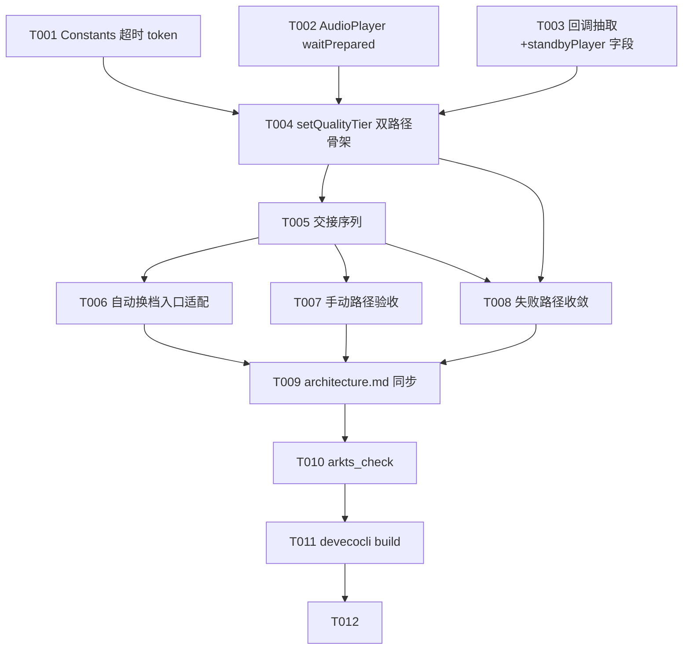

# Tasks: v0.8-part3 无缝音质切换

**Input**: Design documents from `spec/v0.8-part3-seamless-quality-switch/`（spec.md / plan.md）
**Prerequisites**: plan.md（8 项设计决策）、spec.md（3 用户故事）

## Format: `[ID] [P?] [Story] Description`

- **[P]**: 可并行（不同文件、无未完成依赖）
- **[Story]**: 所属用户故事（US1/US2/US3）
- 任务描述含精确文件路径

## Path Conventions

- 单模块工程：源码 `entry/src/main/ets/`，规格 `spec/v0.8-part3-seamless-quality-switch/`
- 文档相对仓库根引用（如 `docs/architecture.md`）

---

## Phase 1: Setup

无需项目初始化任务（既有单模块工程，改动全在既有文件）。

---

## Phase 2: Foundational (Blocking Prerequisites)

**Purpose**: 三文件基建，全部故事的前置

- [x] T001 [P] Constants.ets 新增换档超时 token：`TOKEN_SWITCH_PREPARED_TIMEOUT_MS`（旁路实例 prepared 等待上限 8000）、`TOKEN_SWITCH_PLAY_TIMEOUT_MS`（出声确认上限 3000），归入播放器常量区 — entry/src/main/ets/service/Constants.ets
- [x] T002 [P] AudioPlayer 新增公开方法 `waitPrepared(timeoutMs): Promise<void>`：内部复用既有私有 `waitForState('prepared', timeoutMs)`，超时抛错；既有方法签名零改动 — entry/src/main/ets/service/AudioPlayer.ets
- [x] T003 [P] PlayerController 回调挂载抽取：init 内联的四处回调赋值（onStateChange/onTimeUpdate/onError/onAudioInterrupt）抽为私有公共方法供 init 与换档交接两处复用；新增私有字段 `standbyPlayer: AudioPlayer | undefined`（在途旁路实例唯一归口，非 undefined 即换档在途） — entry/src/main/ets/service/PlayerController.ets

**Checkpoint**: 基建就绪，用户故事实现可开始。

---

## Phase 3: User Story 1 - 换网自动换档无停顿 (Priority: P1) 🎯 MVP

**Goal**: 播放中 Wi-Fi↔流量稳定切换自动换档，旧流全程出声，旁路预载就绪后交接，零静音缝隙。
**Independent Test**: 播放中开关 Wi-Fi，音频连续过渡到新网络默认档，进度连续。

- [x] T004 [US1] setQualityTier 重构为双路径骨架：播放中路径旁路预载（token 校验 → resolve 新档 → `new AudioPlayer()` 挂入 standbyPlayer → setStreamSource 哑回调静默 → waitPrepared → setRate 同步主实例倍速），暂停路径无声变体（预载后不走起播，保持暂停态）；loadToken 各阶段校验沿用，token 失配即释放旁路实例；全程不置 isPreparing，statusMsg「正在切换音质…」照常 — entry/src/main/ets/service/PlayerController.ets
- [x] T005 [US1] 交接序列（播放中路径）：旁路实例 seek 至主实例实时 currentTime → play() → 轮询 `isPlaying` 确认真实出声（上限 `TOKEN_SWITCH_PLAY_TIMEOUT_MS`，超时放弃）→ pause 旧实例 → `this.player = standbyPlayer` → 重挂回调（T003 公共方法）→ release 旧实例；状态字段落定（currentQualityCode/availableTracks/currentTrackSource/currentRequestedTier）+ writeBack 分支保持 + 「已切换 音质名」延迟提示沿用；暂停路径对应替换点（prepared 后 seek 暂停进度 → 引用替换 → release 旧，不 play） — entry/src/main/ets/service/PlayerController.ets
- [x] T006 [US1] 自动换档入口适配：applyDefaultTierForNetwork 在途判定改为「standbyPlayer 非空或 isPreparing」，同档跳过与既有 skip 边界（durl/isPreparing/cid）不变 — entry/src/main/ets/service/PlayerController.ets

**Checkpoint**: US1 端到端可独立验证（真机听感验证留待用户显式要求）。

---

## Phase 4: User Story 2 - 手动切档无停顿 (Priority: P2)

**Goal**: 面板手动切档与自动换档同享无缝机制；暂停态切档保持暂停与进度。
**Independent Test**: 播放中面板切档听感无停顿；暂停中切档后仍暂停、进度不变。

- [x] T007 [US2] 手动切档路径验收整合：确认面板入口（PlayerOverlay 音质面板）经新 setQualityTier 无缝生效，writeBack 按当前网络写回默认档键的既有语义保持；档位显示消费字段（currentQualityCode/currentRequestedTier/availableTracks）在新时序下的更新时机正确（面板选中态/空闲档回退显示不回退） — entry/src/main/ets/service/PlayerController.ets

**Checkpoint**: US2 随 US1 机制自然达成，验收点显式核查。

---

## Phase 5: User Story 3 - 换档失败旧流无感知 (Priority: P3)

**Goal**: 解析失败/预载超时/出声确认超时/中途出错，旧流原档原进度继续播，仅界面提示。
**Independent Test**: 断网后立即切档，旧流继续出声，界面失败提示。

- [x] T008 [US3] 失败路径收敛：各失败点（resolve 异常、setStreamSource/waitPrepared 超时或出错、出声确认超时）统一释放 standbyPlayer、旧流与播放状态字段全程未动、statusMsg 失败提示；随旧流不再被破坏，删除现有「换流阶段失败恢复链」（原 streamBroken 重解析重建逻辑）——失败分支简化为纯放弃 — entry/src/main/ets/service/PlayerController.ets

**Checkpoint**: 三个故事全部独立可验。

---

## Phase 6: Polish & Cross-Cutting

- [x] T009 docs/architecture.md 同步 PlayerController 换档机制描述（重建换流改双播放器旁路交接、standbyPlayer 生命周期归口） — docs/architecture.md

---

## Phase 7: Verification

<!-- verification_scope: build-only -->

**Purpose**: 默认停到真机前——构建验证通过即收尾，不执行真机部署/运行/UI 验证

- [x] T010 静态预检：本轮编辑的所有 .ets 文件（AudioPlayer.ets / PlayerController.ets / Constants.ets）一次性传入 `arkts_check`，修复至通过
- [x] T011 构建验证：`devecocli build`，修复编译错误至通过（同一目标最多 3 次重试，仍失败暂停报告）
- [x] T012 收尾停点：不执行真机部署/UI 验证；输出真机自查事项（换网听感交接无缝、暂停态切档、断网切档保旧、双实例焦点行为——plan D8 登记项）供用户真机核对

---

## Dependencies & Execution Order

### Dependency Graph



### Parallel Execution Guide

| Phase | Tasks | Required Files | Execution Notes |
|-------|-------|----------------|-----------------|
| Foundational | T001, T002, T003 | Constants / AudioPlayer / PlayerController（各一） | 三任务不同文件，可并行 |
| US1 | T004 → T005 → T006 | PlayerController | 同文件严格串行 |
| US2/US3 | T007, T008 | PlayerController | 依赖 T005，同文件串行 |
| Polish | T009 | docs/architecture.md | 独立文件，实现全完成后执行 |

### User Story Dependencies

- **US1 (P1)**: 依赖 Foundational（T001–T003），MVP 主线
- **US2 (P2)**: 依赖 US1 交接序列（T005），机制共享
- **US3 (P3)**: 依赖 T004/T005，失败路径为骨架的收敛分支

## Parallel Example: Foundational

```text
并行起跑（三任务不同文件）：
Task: "T001 Constants 超时 token" — entry/src/main/ets/service/Constants.ets
Task: "T002 AudioPlayer waitPrepared" — entry/src/main/ets/service/AudioPlayer.ets
Task: "T003 回调抽取+standbyPlayer 字段" — entry/src/main/ets/service/PlayerController.ets
```

---

## Implementation Strategy

### 实施轮次建议

改动集中于 3 个源文件、总量 12 任务，建议**单轮一气呵成**（T001→T012 顺序执行，无跨轮拆分价值）；Foundational 三任务可并行起跑。

### Incremental Delivery

1. Foundational（T001–T003）→ 基建就绪
2. US1（T004–T006）→ MVP：换网自动换档无缝可验
3. US2（T007）+ US3（T008）→ 机制收敛，全故事达成
4. Polish（T009）→ 文档同步
5. Verification（T010–T012）→ 静态预检 + 构建 + 真机前停点

---

## Notes

- [P] 任务 = 不同文件、无未完成依赖
- [Story] 标签保证需求可追溯（spec.md 用户故事 ↔ 任务）
- 每个故事独立可验；验证范围默认 build-only（停到真机前），真机自查事项由 T012 输出
- 同一构建目标最多 3 次重试，仍失败暂停报告（无人值守模式规则）

---

## Summary Report

- **总任务数**: 12（Foundational 3 / US1 3 / US2 1 / US3 1 / Polish 1 / Verification 3）
- **每故事计数**: US1=3、US2=1、US3=1
- **并行机会**: T001/T002/T003 三文件并行；其余同文件串行
- **独立测试标准**: US1 换网听感无缝；US2 手动切档无缝+暂停态语义；US3 断网切档保旧流
- **MVP 范围**: T001–T006（US1 端到端）；US2/US3 共享机制增量极小，随同轮完成
