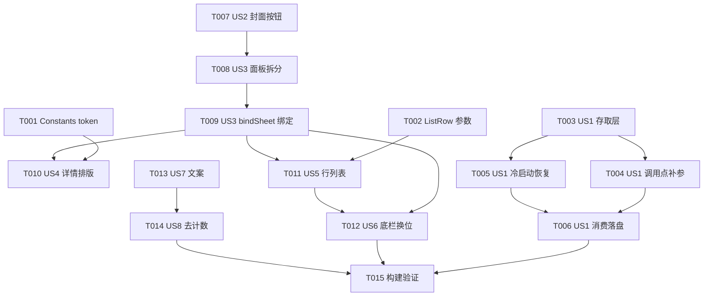

# Tasks: 播放页 UX 反馈修复 + 指定队列持久化

**Input**: Design documents from `spec/v0.8-part4-player-ux-persist/`
**Prerequisites**: plan.md（D1-D9 决策）, spec.md（US1-US8）

**Tests**: 未要求测试任务（项目无测试套件，验证走构建）。

**Organization**: 按用户故事分组；同文件任务串行、跨文件链并行。

**实施轮次建议**: 单批实施——任务总量小（15 项）且无跨轮依赖，Phase 4 一次完成全部实施。

## Format: `[ID] [P?] [Story] Description`

- **[P]**: 可并行（不同文件、无未完成依赖）
- **[Story]**: 所属用户故事（映射 spec.md US1-US8）
- 描述含精确文件路径

## Path Conventions

- 单项目仓库根：`entry/src/main/ets/` 下 `service/`、`pages/`、`component/`、`model/`
- 任务描述中的文件路径均相对仓库根

---

## Phase 1: Setup

（无——既有项目零新增结构、零新增依赖、零新增资源，直接进入 Foundational。）

---

## Phase 2: Foundational (Blocking Prerequisites)

**Purpose**: 两个用户故事的共享前置（token 与共享组件参数），完成前 US4/US5 不得开工。

- [X] T001 [P] Constants.ets 新增正文行高 token `TOKEN_LINE_HEIGHT_DESC = 28`（含一行注释：详情简介行高，替代既有裸 24），并同步「队列末播放」相关注释口径为「添加至队列末」 — `entry/src/main/ets/service/Constants.ets`
- [X] T002 [P] ListRow.ets 新增两个可选参数 `selected: boolean = false`（选中态：图标与标题主题色高亮 + 行尾 ✓）与 `iconRotate: number = 0`（图标旋转角）；默认值下现有全部调用方渲染逐像素不变 — `entry/src/main/ets/component/ListRow.ets`

**Checkpoint**: token 与 ListRow 扩展就绪，各用户故事可开工。

---

## Phase 3: User Story 1 - 指定名单跨重启有效 (Priority: P1) 🎯 MVP

**Goal**: 「下一首播放」指定名单随 playlist.json 持久化，冷启动过滤重建，消费路径同步落盘。

**Independent Test**: 随机模式设置指定 →（逻辑层面核验：playlist.json 出现 designated 字段且含该 key；冷启动恢复代码路径将其过滤重建进 designatedNextQueue）。

- [X] T003 [P] [US1] savePlaylistFile 增第 5 参 `designatedKeys: string[]` 并写入根对象 `'designated'` 字段；loadPlaylistFile 解析 `'designated'`（缺省空数组、损坏走既有 catch 空快照路径）写入 PlaylistSnapshot 新字段 `designatedKeys: string[]`（PlaylistSnapshot 定义处同步加字段） — `entry/src/main/ets/service/AppStore.ets`
- [X] T004 [US1] 全部 savePlaylistFile 调用点（15 处）补传 `this.designatedNextQueue` 作第 5 实参 — `entry/src/main/ets/service/PlayerController.ets`（依赖 T003）
- [X] T005 [US1] 冷启动恢复处（loadPlaylistFile 调用点）：items 恢复后将 snapshot.designatedKeys 按「队列中存在该 key」过滤（顺序保留）赋值 designatedNextQueue，不存在 key 静默丢弃 — `entry/src/main/ets/service/PlayerController.ets`（依赖 T003）
- [X] T006 [US1] markSessionPlayed 的指定键消费分支（`designated next consumed on play` 日志处）补一次 savePlaylistFile 调用，消费即落盘 — `entry/src/main/ets/service/PlayerController.ets`

**Checkpoint**: US1 服务层闭环——登记/移动/消费/移除/清空各路径均同步落盘，重启恢复过滤重建。

---

## Phase 4: User Story 2 - 封面「视频」按钮可见性 (Priority: P2)

**Goal**: 封面右下「视频」药丸在纯白封面下清晰可辨。

**Independent Test**: 药丸底色为 duration_badge_scrim（深色蒙层）、图标与文字为 fg_on_dark（白）。

- [X] T007 [P] [US2] 封面「视频」药丸：底改 `duration_badge_scrim`、前景（play_round_rectangle 图标 + 「视频」文字）改 `fg_on_dark`；去除 btn_glass/backdropBlur 玻璃配方 — `entry/src/main/ets/pages/PlayerOverlay.ets`

---

## Phase 5: User Story 3 - 窄屏选择面板底部浮窗化 (Priority: P2)

**Goal**: 窄屏（<600vp）五个选择面板（倍速/播放顺序/定时关闭/自定义定时/音质）以系统 bindSheet 低高度底部浮窗呈现；宽屏保持现状居中弹窗；双轨同状态驱动、断点切换即时换形态。

**Independent Test**: 宽屏 overlay 条件 `isWide && showX`；窄屏 bindSheet isShow 为 `!isWide && showX` 派生；FIT_CONTENT/BOTTOM/dragBar 统一 options。

- [X] T008 [US3] 五个面板 builder 拆分「内容/外壳」：面板选项内容保留为共用内容 builder；宽屏 wrapper（mask_heavy + 居中 76% 卡片 + 点击关闭）仅宽轨渲染，overlay 挂载条件加 `isWide &&`；窄屏不再渲染 overlay 形态 — `entry/src/main/ets/pages/PlayerOverlay.ets`
- [X] T009 [US3] 五个 bindSheet 窄轨绑定（依赖 T008）：倍速→倍速按钮 Row、定时→定时按钮 Row、音质→音质按钮 Row、播放顺序→播放模式按钮 Row、自定义定时→队列按钮 Row（借宿主，注释说明单节点单 sheet 约束）；options 统一 `height: SheetSize.FIT_CONTENT, dragBar: true, showClose: false, preferType: SheetType.BOTTOM, backgroundColor: Color.Transparent, maskColor: $r('app.color.mask_heavy')`（遮罩与队列 GlassSheet 一致）；内容根按 isWide 条件自绘玻璃公式（窄轨 `sheet_panel_background` + `backdropBlur(GLASS_BLUR)` + 顶部分隔线，宽轨取空值维持卡片形态）——与队列/详情面板透明度统一；isShow 为 `!isWide && showX` 派生表达式；onDisappear 同步关闭标志（对齐既有 showDetail 模式） — `entry/src/main/ets/pages/PlayerOverlay.ets`

**Checkpoint**: US3 双轨可用——窄屏五入口均为低高度浮窗且可关，浮窗底色与队列面板玻璃公式一致，宽屏逐像素维持现状。

---

## Phase 6: User Story 4 - 详情简介排版与滚动条 (Priority: P2)

**Goal**: 详情 sheet 简介区边距/行高舒展，滚动条不压简介文字。

**Independent Test**: 简介行高用 TOKEN_LINE_HEIGHT_DESC（T001）；滚动内容右 padding 留出滚动条槽。

- [X] T010 [US4] detailSheet 排版：简介 Text 行高改 `Constants.TOKEN_LINE_HEIGHT_DESC`（替代裸 24）；简介滚动内容加右侧 padding 形成滚动条专属槽（滚动条落于留白内）；detailSheet 内边距上下/左右用既有 TOKEN_SPACE 系 token 上调一档 — `entry/src/main/ets/pages/PlayerOverlay.ets`（依赖 T001）

---

## Phase 7: User Story 5 - 选择面板行列表（ListRow） (Priority: P3)

**Goal**: 底栏四菜单（倍速/定时/音质/播放顺序）选项统一 ListRow 全宽行列表：播放顺序图标在前（四态映射、倒序旋转 180°）、行尾 ✓ 标当前项。

**Independent Test**: 四菜单选项均为 ListRow 行；播放顺序四行（rowIcon + title + selected + iconRotate + rowAction）选中行图标/标题主题色高亮；倍速/定时/音质行结构一致。

- [X] T011 [US5] 四菜单选项改 ListRow 行列表：播放顺序每行 `rowIcon` 取 playModeIcon 四态映射、`iconRotate` 倒序 180 其余 0、`selected` 为当前模式、`rowAction` 调 setPlayMode 并关闭面板；倍速六档/音质 dash 音轨为普通行（`selected` 当前档 + 行尾 ✓，`rowAction` 设置并关闭）；定时面板与底层单选模型对齐——预设/自定义/播完暂停均为单选行（激活档位 `selected` ✓，自定义激活时行尾 valueText 显示设定时长；播完暂停点击武装并关闭面板，toggle 开关形态废弃）、定时入口播完暂停武装时表盘图标旁显示主题色 pause 小图标（后缀槽与倒计时剩余数字同位同字号）、选档生效延迟到面板关闭动画之后（启动/武装/取消经延迟 helper 执行，防条件插入的「取消定时」红行闪现）、「取消定时」（激活时）危险行；音质空闲态文案与 durl「默认」单行保持既有语义；内容 builder 双轨共用（宽屏 overlay 与窄屏 sheet 同形） — `entry/src/main/ets/pages/PlayerOverlay.ets`（依赖 T002、T008）

---

## Phase 8: User Story 6 - 播放顺序与定时换位 (Priority: P3)

**Goal**: 底栏五按钮新序：倍速、定时、音质、播放模式、队列。

**Independent Test**: 按钮渲染顺序为新序，各按钮触发的面板/功能不变（bindSheet 宿主节点随按钮移动）。

- [X] T012 [US6] 底部操作行按钮重排为「倍速、定时、音质、播放模式、队列」，节点级移动（bindSheet 绑定随节点走，无逻辑改动） — `entry/src/main/ets/pages/PlayerOverlay.ets`（建议排在 T009 后执行，避免宿主节点移动与绑定穿插）

---

## Phase 9: User Story 7 - 文案统一「添加至队列末」 (Priority: P3)

**Goal**: 全部用户可见「队列末播放」文案改「添加至队列末」。

**Independent Test**: 源页多选按钮与设置页单曲插入位置选项均为新文案；全库检索无「队列末播放」用户可见字样。

- [X] T013 [P] [US7] 文案替换：源页多选按钮（队列末播放 → 添加至队列末）、设置页单曲插入位置选项文案与选项数组（含 `'队列末播放', '下一首播放'` 两处）、相关注释口径 — `entry/src/main/ets/pages/SourcePage.ets`、`entry/src/main/ets/pages/SettingsPage.ets`

---

## Phase 10: User Story 8 - 源页多选按钮去计数 (Priority: P3)

**Goal**: 源页多选底部两枚胶囊按钮不显示 (N) 计数，顶栏「已选 N 项」为计数唯一展示点。

**Independent Test**: 按钮模板串为纯功能文字，无 `(${selectedKeys.size})` 拼接。

- [X] T014 [US8] 两枚胶囊按钮模板串去除 `(${this.selectedKeys.size})` 拼接（「添加至队列末」「下一首播放」） — `entry/src/main/ets/pages/SourcePage.ets`（排在 T013 后，同文件）

---

## Phase 11: Verification

<!-- verification_scope: build-only -->

**Purpose**: 构建验证与修复（项目默认停到真机前：构建通过即收尾，真机自查由用户执行）。

- [X] T015 静态检查与构建修复：本轮编辑的全部 `.ets` 文件执行 `devecocli check arkts <files>` 清零错误，随后 `devecocli build` 至成功（同一目标最多 10 次构建），通过即收尾停点 — 仓库根

---

## 📊 Dependency Graph



## Dependencies & Execution Order

### Phase Dependencies

- **Foundational（Phase 2）**: T001/T002 无前置，立即可做；完成前 US4（T010）、US5（T011）不得开工
- **US1 服务链（Phase 3）**: T003 先行（签名变更），T004/T005 依赖 T003，T006 收尾；与 UI 链不同文件组，可并行
- **PlayerOverlay 链（Phase 4-8）**: T007 → T008 → T009 → T010/T011/T012 同文件严格串行
- **文案链（Phase 9-10）**: T013 → T014 同文件串行；与其它链不同文件组，可并行
- **Verification（Phase 11）**: 三链全部完成后执行

### User Story Dependencies

- US1（P1）：仅依赖 T003 链内顺序，无跨故事依赖
- US2/US3/US4/US5/US6（P2/P3）：共享 PlayerOverlay.ets，串行执行；US4 另依赖 T001，US5 另依赖 T002/T008
- US7/US8（P3）：T014 依赖 T013（同文件），与其它故事零耦合

### Within Each User Story

- 服务层（AppStore/PlayerController）先于消费方调用点改造
- 面板拆分（T008）先于 bindSheet 绑定（T009），绑定先于底栏换位（T012）
- 文案替换（T013）先于去计数（T014）

## Parallel Example

```bash
# 三链并行启动（不同文件组）：
链1（服务层）: T003 → T004 → T005 → T006   # AppStore.ets / PlayerController.ets
链2（播放层）: T007 → T008 → T009 → T010 → T011 → T012   # PlayerOverlay.ets
链3（文案）:   T013 → T014                  # SourcePage.ets / SettingsPage.ets
# 三链汇合后：
T015                                      # 全部改动文件 check + build
```

## Parallel Execution Guide

| Phase | Tasks | Required Files | Execution Notes |
|-------|-------|---------------|-----------------|
| Foundational | T001, T002 | Constants.ets / ListRow.ets | 两任务不同文件，可并行 |
| US1 服务链 | T003 → T004 → T005 → T006 | AppStore.ets / PlayerController.ets | T003 先行（签名变更），T004/T005 同文件串行，T006 收尾 |
| PlayerOverlay 链 | T007 → T008 → T009 → T010 → T011 → T012 | PlayerOverlay.ets | 同文件严格串行；T010 依赖 T001，T011 依赖 T002 |
| 文案链 | T013 → T014 | SourcePage.ets / SettingsPage.ets | 与前两链并行（不同文件）；T014 依赖 T013（同文件） |
| Verification | T015 | 全部改动文件 | 三链全部完成后执行 |

## Implementation Strategy

### MVP First（US1 单故事交付）

1. Foundational：T001/T002（US1 不依赖，可跳过先做 MVP）
2. US1 链：T003 → T004 → T005 → T006
3. 构建验证 T015 → US1 即为可独立交付的最小增量（指定队列持久化）

### Incremental Delivery（本单批实施）

1. Foundational → 三链并行（服务层 / 播放层 / 文案）→ T015 一次性构建验证
2. 全部 15 任务在 Phase 4 单批完成，不分批交付

## Notes

- 同文件任务（PlayerOverlay 链、文案链）必须串行，避免编辑冲突。
- T005 冷启动恢复的过滤语义：顺序保留、失效 key 静默丢弃、旧文件缺字段走空名单。
- T009 借宿主（自定义定时 → 队列按钮 Row）必须留一行注释说明单节点单 bindSheet 约束。
- T012 为节点级移动：底栏换位后 bindSheet 宿主随节点移动，不重写绑定逻辑。
- 验证收尾停点：构建通过即停，真机自查清单由主代理在轮次总结输出。
