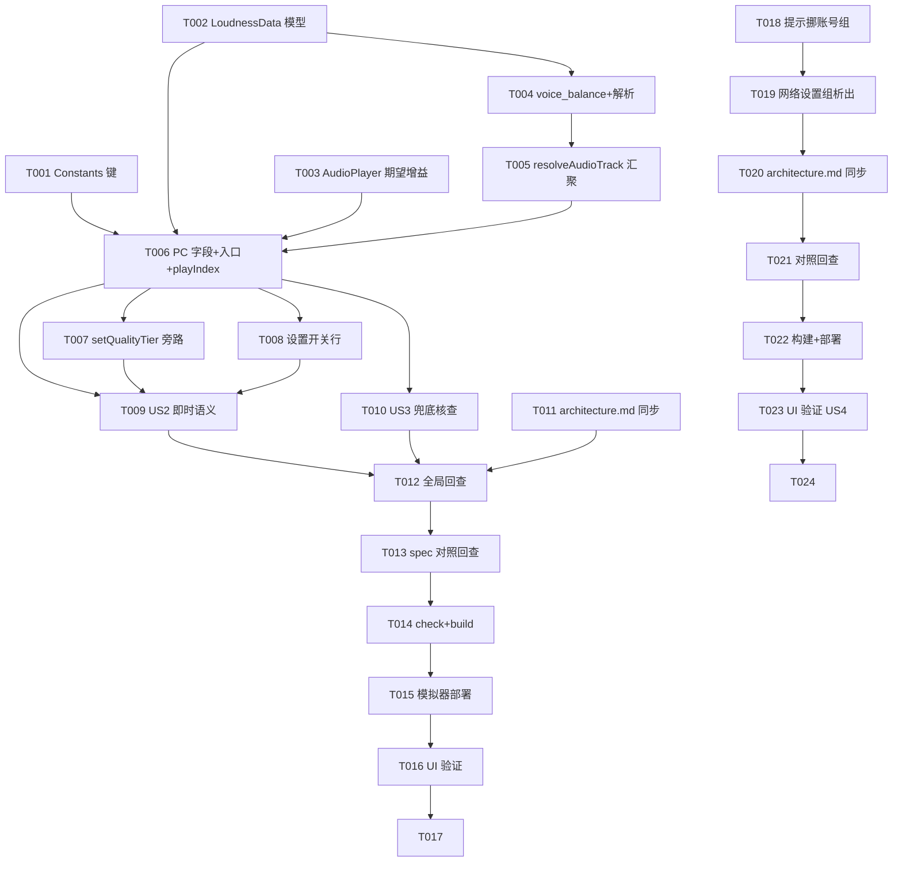

# Tasks: 音量均衡（服务端响度归一）+ 设置页重排（账号组音质提示/网络设置独立组）

**Input**: Design documents from `spec/v0.8-part5-volume-balance/`
**Prerequisites**: plan.md（D1-D9 决策）、spec.md（US1-US4 + FR-001~011）、`BILI_NOTES.md` §3.14（API 实测依据）

**Tests**: 未要求测试任务（项目无测试套件，验证走构建）；增益公式以 §3.14 样本值（gain ≈ -6.6 / -0.5 dB）为真机日志验证锚点。

**Organization**: 按用户故事分组；同文件任务串行、跨文件链并行。本轮为增量扩展批次：T001-T017（音量均衡）已实施并验证完毕，T018+（设置页重排，原 v0.8-part6 并入）为扩展批次。

**实施轮次建议**: 双批次——批次一（T001~T017）已完成；批次二（T018~T024）任务量小且单文件为主，Phase 4 一次完成全部实施。

## Format: `[ID] [P?] [Story] Description`

- **[P]**: 可并行（不同文件、无未完成依赖）
- **[Story]**: 所属用户故事（映射 spec.md US1-US4）
- 描述含精确文件路径

## Path Conventions

- 单项目仓库根：`entry/src/main/ets/` 下 `service/`、`pages/`、`component/`、`model/`
- 任务描述中的文件路径均相对仓库根

---

## Phase 1: Setup

（无——既有项目零新增结构、零新增依赖、零新增文件，直接进入 Foundational。）

---

## Phase 2: Foundational (Blocking Prerequisites)

**Purpose**: 三件公共基础设施（常量键 / 数据模型 / 播放器期望增益机制），全部完成后故事可开始。

- [X] T001 [P] `entry/src/main/ets/service/Constants.ets`：新增 `KEY_VOLUME_BALANCE: string = 'volumeBalance'`（preferences 0/1 数字模式，默认 0=关闭，沿 KEY_INTERRUPT_RESUME 先例注释口径）
- [X] T002 [P] `entry/src/main/ets/model/AudioQuality.ets`：新增 `LoudnessData` 类——字段 `measuredI/measuredTp/targetI/undersizedTargetI`（缺失回退按 plan D5：tp→0、undersized→-Infinity）、类常量 `GAIN_MIN_DB=-90`/`GAIN_MAX_DB=24`（附 model 零依赖边界注释）、静态 `parseVolume(raw)`（volume 缺失或 measured_i/target_i 非有限数值返回 undefined；undersized_target_i 自 multi_scene_args 字符串 map 解析）、静态 `computeGainDb()`（守卫序：undersized 跳过→防削波钳制仅放大方向（plan D4）→区间钳制）；`ResolvedAudio` 增加 `loudness: LoudnessData | undefined = undefined` 字段
- [X] T003 [P] `entry/src/main/ets/service/AudioPlayer.ets`：期望增益机制（desiredRate 同款）——私有 `desiredLoudnessGainDb` 字段、公开 `setLoudnessGainDb(db)`（存期望值；avPlayer 已 prepared 时立即 `setLoudnessGain`，Promise catch 静默记日志、期望值保留（plan D7））、`setupCallbacks` 的 prepared 分支在 `setPlaybackRate` 旁统一应用期望增益

**Checkpoint**: 模型与播放器机制就绪，故事实现可开始。

---

## Phase 3: User Story 1 - 开启后自动响度对齐 (Priority: P1) 🎯 MVP

**Goal**: 开启「音量均衡」后，播放任一有响度数据的视频自动按 `gain = target_i − measured_i` 对齐响度。

**Independent Test**: 开启开关播放 §3.14 样本类内容，日志出现 gain 值（过响内容 ≈ -6.6 dB 量级），听感对齐。

### Implementation for User Story 1

- [X] T004 [US1] `entry/src/main/ets/service/BiliService.ets`：`fetchDashAudioTracks` 与 `fetchDurlCandidates` 请求 URL 追加 `&voice_balance=1`（plan D1/D8）；`DashFetchResult`/`DurlFetchResult` 内部类各增 `loudness: LoudnessData | undefined = undefined`，自响应 `data.volume` 经 `LoudnessData.parseVolume` 解析填充
- [X] T005 [US1] `entry/src/main/ets/service/BiliService.ets`：`resolveAudioTrack` 两链（dash 含重试分支 / durl 兜底）loudness 汇聚进 `ResolvedAudio.loudness`
- [X] T006 [US1] `entry/src/main/ets/service/PlayerController.ets`：私有 `currentLoudness` 字段（随每次 resolve 刷新）+ 私有开关读取（`AppStore.getNumber(KEY_VOLUME_BALANCE, 0) === 1`）+ 公开 `setVolumeBalance(enabled: boolean)` 入口（重算并即时应用）+ 私有增益计算应用方法（开启且有数据→`computeGainDb()`，其余→0；Logger 'player' 埋点：开关态、gain 两位小数、measured/target 摘要、跳过原因）+ `playIndex` resolve 后存 `currentLoudness` 并在 `openStreamWithRetry(this.player, ...)` 前置应用增益
- [X] T007 [US1] `entry/src/main/ets/service/PlayerController.ets`：`setQualityTier` 旁路——standby resolve 后刷新 `currentLoudness`，`openStreamWithRetry(standby, ...)` 前对 standby 前置 `setLoudnessGainDb`（换档增益不丢不错配，spec FR-007）
- [X] T008 [US1] `entry/src/main/ets/pages/SettingsPage.ets`：播放设置组新增「音量均衡」ListRow——标题「音量均衡」、说明「自动平衡不同视频间的音量大小」、`showToggle`；`@Local volumeBalanceOn` 初值 `aboutToAppear` 自 AppStore 读取；`toggleChange` 持久化（0/1）+ `PlayerController.getInstance().setVolumeBalance(isOn)`；行形态沿播放设置组既有行

**Checkpoint**: MVP 完成——开关开启后新播放内容自动响度对齐，换档/切歌增益正确。

---

## Phase 4: User Story 2 - 开关切换即时生效 (Priority: P2)

**Goal**: 播放中切换开关，当前曲目立即应用/恢复增益，不中断不重取流。

**Independent Test**: 播放中开→关→开，听感即时变化、播放不中断、无网络请求。

### Implementation for User Story 2

- [X] T009 [US2] `entry/src/main/ets/service/PlayerController.ets`：即时生效语义核查与补齐——对照 spec US2 验收场景逐条核查：播放中切换（`setLoudnessGainDb` 已 prepared 即时路径）、暂停中切换（paused 态可调）、completed 态切换、preparing 中切换（期望值随 prepared 落地）、切换零重新取流（复用 `currentLoudness`）；不足处补齐并补日志（开关切换事件埋点）

**Checkpoint**: 开关完全可逆、即时、零中断。

---

## Phase 5: User Story 3 - 无数据与异常兜底 (Priority: P3)

**Goal**: 无数据/异常/失败路径全部静默不增益，仅日志，播放零干扰。

**Independent Test**: 无 volume 数据内容正常播放，日志出现可区分的跳过原因，无用户可见异常。

### Implementation for User Story 3

- [X] T010 [US3] `entry/src/main/ets/service/PlayerController.ets` + `entry/src/main/ets/service/AudioPlayer.ets`：兜底路径核查与补齐——对照 spec US3 验收场景与 FR-006 逐条核查：volume 缺失（parseVolume→undefined）、`measured_i < undersized_target_i` 可疑测量守卫、`measured_tp` 缺失（保守 0 防削波）、`multi_scene_args` 缺失、durl 兜底链、`setLoudnessGain` Promise 失败（静默+日志+期望值保留）；日志各跳过原因可区分；确认任何失败路径不影响 openStreamWithRetry/prepare/play 既有流程

**Checkpoint**: 全部失败路径静默降级，播放体验零劣化。

---

## Phase 6: User Story 4 - 设置页重排：音质提示归位账号组 + 网络设置独立成组 (Priority: P1)

**Goal**: 未登录/非会员音质提示挪至账号组卡片内底部，「Wi-Fi 默认音质」「移动网络默认音质」「仅在 Wi-Fi 环境播放」三行析出为独立「网络设置」组，功能零回归。

**Independent Test**: 三种登录态打开设置页核对提示位置与组结构；操作迁移三行确认功能不变。

### Implementation for User Story 4

- [X] T018 [US4] `entry/src/main/ets/pages/SettingsPage.ets`：FR-009——音质提示 Text（未登录态「未登录时最高 64K，登录后可用更高音质」/非会员态「192K/Hi-Res/杜比需大会员」）挪入账号组卡片内底部：已登录分支「取消收藏提醒」行之后、未登录分支二维码块之后（组卡内最底）；条件渲染三态判定沿现状（大会员/冷启动占位不渲染）；「播放设置」组内原位置移除；样式沿现主题色小字形态仅位置变化
- [X] T019 [US4] `entry/src/main/ets/pages/SettingsPage.ets`：FR-010——「Wi-Fi 默认音质」「移动网络默认音质」「仅在 Wi-Fi 环境播放」三行（含全部 toggle/弹层/持久化代码）析出为新「网络设置」SettingsGroup，插于「播放设置」组之后；「播放设置」组恰保留启动时自动播放、后台打断续播、音量均衡、单集插入位置四行；页面其余组序不变；divider 按新组内位置重排（FR-011：非末行有、末行无）

**Checkpoint**: 提示归位账号组、网络设置独立成组，组结构对齐 spec US4 验收场景 1-3。

---

## Phase 7: Polish & Cross-Cutting Concerns

- [X] T011 [P] `docs/architecture.md` 同步：`AudioPlayer.ets` 职责（响度增益期望机制）、`BiliService.ets` 取流（voice_balance=1 / volume 解析）、`SettingsPage.ets` 播放设置组描述、源码结构表（零文件增删仅职责变更）；「模块依赖与边界」零变化确认
- [X] T012 全局回查：全部改动 `.ets` 文件跑 `devecocli check arkts` 严格模式零诊断；确认无 `any`/`unknown`/`as` 断言、无裸数字（GAIN_* 类常量带边界注释、魔法数字归位）；grep 确认两处 playurl 请求（dash/durl）`voice_balance=1` 无遗漏、`KEY_VOLUME_BALANCE` 消费点完整（Constants 定义 / SettingsPage 读写 / PlayerController 读取）
- [X] T013 spec 对照回查：FR-001~FR-008 逐条核查实现覆盖（FR-008 关闭态零回归：voice_balance 恒携带下关闭行为与现版本用户可感知一致性确认）；spec US1~US3 验收场景全覆盖确认；实施与 spec/plan 偏差如有则就地修订工件条目（本轮功能再优化口径）
- [X] T020 [P] `docs/architecture.md` 同步（批次二）：`SettingsPage.ets` 描述更新——账号组卡内底部音质提示、播放设置组（四行）与网络设置组（三行）结构；源码结构表零文件增删确认
- [X] T021 对照回查（批次二）：`SettingsPage.ets` 执行 `devecocli check arkts` 清零错误；FR-009~FR-011 逐条核查（FR-011 零回归：迁移行代码仅位置变化、qualitySheet 音质弹层与其顶部 notice 零触碰、无新增逻辑/依赖）；spec US4 验收场景（4 条）覆盖确认，偏差就地修订工件条目

---

## Phase 8: Verification

<!-- verification_scope: build+ui -->

**Purpose**: 构建 + 模拟器部署 + UI 实测（用户显式要求模拟器 UI 验证；全流程依 `docs/agents/verifying.md`）；分两批执行。

**批次一（音量均衡，已完成）**:

- [X] T014 静态检查与构建修复：本轮编辑的全部 `.ets` 文件执行 `devecocli check arkts <files>` 清零错误，随后 `devecocli build` 至成功（同一目标最多 10 次构建）
- [X] T015 模拟器部署：`devecocli emulator start <name>`（位置参数，启动分钟级设长超时）→ `devecocli run --skip-build --device <模拟器>`；部署后确认应用可启动、测试数据在位（无订阅时经首页「＋」入口粘贴样本 BV 号添加订阅）
- [X] T016 UI 验证（模拟器）：按 spec US1~US3 用例逐故事验证（每故事 ≤3 次尝试）；`devecocli ui` 工具链断言 + 落盘日志 `biliradio_log.txt` 取证 volumeBalance gain/skip/setVolumeBalance 行；锁屏/工具链坑按 verifying.md §3.2 处置
- [X] T017 收尾停点：汇总验证结论（每故事 PASS/FAIL/SKIP + 截图/日志依据）；模拟器实测新发现（volume 命中率、skip 原因分布）补录 `BILI_NOTES.md` §3.14

**批次二（设置页重排）**:

- [X] T022 构建与模拟器部署：`devecocli build` 至成功；模拟器按 verifying.md §2 启动（在运行则复用），`devecocli run --skip-build` 部署最新构建
- [X] T023 UI 验证（模拟器）US4：账号组卡内底部提示位置与文案——未登录态模拟器实测（二维码块之后、原位置无残留）；已登录/大会员态无测试账号时按条件渲染代码核查并在报告标注；「播放设置」组恰四行、「网络设置」组恰三行断言；迁移三行功能零回归（toggle 持久化、音质弹层触发与顶部 notice、取值展示）；每故事 ≤3 次尝试
- [X] T024 收尾停点（批次二）：汇总验证结论（PASS/FAIL + 截图/日志依据）；测试收尾暂停播放并清理本轮截图（verifying.md §3.4 步骤 7）；设置页重排实测新发现如有则补录工件

---

## 📊 Dependency Graph



## Dependencies & Execution Order

### Phase Dependencies

- **Foundational（Phase 2）**: T001/T002/T003 无前置、三文件互不相依，可并行；完成前任何故事不得开工
- **BiliService 链（US1）**: T004 → T005 同文件严格串行（递进改造）
- **PlayerController 链（US1-US3）**: T006 先行（字段+入口+playIndex 应用点），T007/T009/T010 同文件依赖 T006 串行推进
- **SettingsPage（US1）**: T008 依赖 T006（setVolumeBalance 入口）；与 PlayerController 链不同文件，T006 完成后可并行
- **Polish（Phase 7）**: T011 可与 T009/T010 并行（纯文档）；T012 依赖全部代码任务与 T011；T013 收尾
- **Verification（Phase 8）**: T014 → T015 → T016 → T017 串行（批次一）；T022 → T023 → T024 串行（批次二，待批次二代码全部完成后执行）
- **批次二（US4）**: T018 → T019 同文件严格串行（账号组落位→组拆分递进）；T020 依赖 T018/T019 终态；T021 收尾核查

### User Story Dependencies

- US1（P1）：T004→T005→T006 主链，T007/T008 依赖 T006；跨 BiliService/PlayerController/SettingsPage 三文件组
- US2（P2）：T009 依赖 T006/T007/T008（即时切换语义建立在完整 MVP 之上）
- US3（P3）：T010 依赖 T006（兜底核查建立在应用点之上）；与 T007/T008 可并行（同文件不同关注面，单人实施按 ID 顺序）
- US4（P1，批次二）：T018→T019 主链（SettingsPage 单文件纯 UI 重排）；依赖批次一已就位的播放设置组结构（音量均衡行已入组），无数据/服务层改动

### Within Each User Story

- 数据模型（T002）先于解析（T004/T005），解析先于应用（T006）
- 播放器机制（T003）先于应用点（T006/T007）
- 设置开关（T008）后于 setVolumeBalance 入口（T006）
- 提示归位（T018）先于组拆分（T019）——原提示位置在播放设置组内三行之间，先移除避免拆组时节点归属纠缠

## Parallel Example

```bash
# Foundational 三任务并行启动（不同文件）：
T001                     # Constants.ets
T002                     # AudioQuality.ets (LoudnessData)
T003                     # AudioPlayer.ets (期望增益机制)
# 汇合后 BiliService 链：
T004 → T005              # BiliService.ets（同文件串行）
# 与 PlayerController 链并行（不同文件组）：
T006 → T007 → T009 → T010   # PlayerController.ets（+T010 涉及 AudioPlayer.ets）
T008                     # SettingsPage.ets（T006 完成后随时可插入）
# 全部代码完成后：
T011 → T012 → T013 → T014 → T015 → T016 → T017   # 文档同步 → 回查 → 构建验证 → 部署 → UI 实测 → 收尾
# 批次二（设置页重排）：
T018 → T019              # SettingsPage.ets（同文件串行，纯 UI 重排）
T020 → T021              # architecture.md 同步 → 对照回查
T022 → T023 → T024       # 构建部署 → US4 UI 实测 → 收尾
```

## Parallel Execution Guide

| Phase | Tasks | Required Files | Execution Notes |
|-------|------|---------------|-----------------|
| Foundational | T001, T002, T003 | Constants.ets / AudioQuality.ets / AudioPlayer.ets | 三任务不同文件，可并行 |
| BiliService 链 | T004 → T005 | BiliService.ets | 同文件严格串行；T004 依赖 T002 |
| PlayerController 链 | T006 → T007 → T009 → T010 | PlayerController.ets（T010 另涉 AudioPlayer.ets） | 同文件严格串行；T006 依赖 T001/T002/T003/T005 |
| 设置开关 | T008 | SettingsPage.ets | T006 完成后可与 T007/T009/T010 并行 |
| Polish（批次一） | T011 → T012 → T013 | docs/architecture.md + 全部改动文件 | T011 可与 T009/T010 并行；T012/T013 串行收尾 |
| US4 链（批次二） | T018 → T019 | SettingsPage.ets | 同文件严格串行；纯 UI 重排零逻辑改动 |
| Polish（批次二） | T020 → T021 | docs/architecture.md + SettingsPage.ets | T020 待 T018/T019 终态；T021 收尾核查 |
| Verification（批次一） | T014 → T015 → T016 → T017 | 全部改动文件 + 模拟器 | 全部批次一任务完成后执行；构建 → 部署 → 逐故事 UI 实测 → 收尾 |
| Verification（批次二） | T022 → T023 → T024 | SettingsPage.ets + 模拟器 | 批次二代码全部完成后执行；构建 → 部署 → US4 UI 实测 → 收尾 |

## Implementation Strategy

### MVP First（US1 单故事交付）

1. Foundational：T001/T002/T003
2. US1 链：T004 → T005 → T006 → T007 → T008
3. 构建验证 T014 → US1 即为可独立交付的最小增量（开关开启自动响度对齐）

### Incremental Delivery（批次一）

1. Foundational → BiliService 链与 PlayerController 链（T008 随后插入）→ US2/US3 核查补齐 → Polish → Verification
2. 批次一全部任务已完成并验证通过（US1~US3 均 PASS）

### 增量批次二（设置页重排）

1. T018 → T019（SettingsPage 单文件纯重排）→ T020 文档同步 → T021 回查 → T022~T024 验证
2. 批次二与批次一无代码交叉（批次一改动已验证冻结），可独立交付

## Notes

- 同文件任务（BiliService 链、PlayerController 链）必须串行，避免编辑冲突。
- T002 类常量放 model 类内是「model 禁止 import Constants」边界的豁免：命名常量非裸数字，注释附边界说明（plan D 决策）。
- T006 增益应用点是「resolve 后、openStreamWithRetry 前」——与 desiredRate 同一时刻语义，勿在 prepared 回调外散落调用。
- T007 换档旁路的增益必须在 standby 上前置（openStreamWithRetry(standby) 前），主播放器重建后由期望值机制兜底。
- T009/T010 是核查补齐型任务：先逐条对照 spec 验收场景核查现状（T006 已实现大半语义），确认不足再补，勿重复实现。
- 批次二是纯 UI 结构调整：迁移节点只挪位置不改代码，FR-011 靠「迁移行代码逐行对照（diff 仅位置变化）+ qualitySheet 弹层与其顶部 notice 零触碰」保证。
- T018 先于 T019：原提示位置夹在待拆三行之间，先移除使 T019 拆组时节点归属清晰。
- T023 三登录态：未登录态模拟器实测；已登录/大会员态无测试账号时按条件渲染代码核查并在验证报告标注。
- 验证收尾：模拟器实测结论 + volume 命中率实测数据回填 `BILI_NOTES.md` §3.14（批次一已完成）；剩余真机自查项（听感对齐）由主代理在轮次总结输出。
